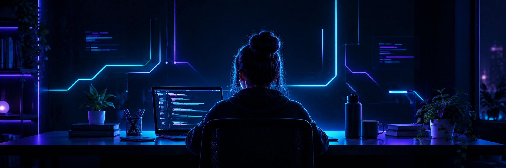

<!-- BANNER -->

  

<h1 align="center">Hi 👋, I'm Radhika Kandalkar</h1>

  

  

---

## ⚡ Quick Snapshot

| | |
|---|---|
| 🎓 **Education** | Third-year Computer Engineering, MITAOE, Pune |
| 💻 **Focus** | Full-Stack Development · Data Structures & Algorithms |
| 🔭 **Exploring** | AI Agents · System Design · Cloud Computing · Web3 |
| 🎯 **Goal** | Software engineering internships & placements |
| 🤝 **Open to** | Collaboration, open source, and continuous learning |

---

## 🧰 Tech Stack

**Languages**

  

**Frontend**

  

**Backend & Databases**

  

**Tools & Platforms**

  

---

## 🚀 Featured Projects

<table>
  <tr>
    <td width="33%" valign="top">
      <h3>🚗 SmartRide</h3>
      <b>Smart Carpooling Platform</b>
      
Connects commuters, matches routes, and makes everyday travel cheaper and more convenient.

      
      
      
    </td>
    <td width="33%" valign="top">
      <h3>🤖 AI Buddy</h3>
      <b>Virtual Meeting Assistant</b>
      
Summarizes discussions, extracts action items, tracks decisions, and answers meeting-related questions.

      
      
    </td>
    <td width="33%" valign="top">
      <h3>🎯 PrepPulse</h3>
      <b>Interview Preparation Platform</b>
      
Helps students prepare for technical interviews with curated questions, company-focused prep, and AI-assisted learning.

      
      
    </td>
  </tr>
</table>

---

## 🧩 DSA & Problem Solving

  

<b>My approach to problem solving</b>

 

- 🧠 Understand the problem first, then brute force, then optimize.
- 📈 Consistency over intensity: a little practice every day.
- 🔁 Revisit mistakes and re-solve hard problems.
- 🎯 Building towards stronger technical interview preparation.

---

## 📈 GitHub at a Glance

  
  

  

---

## 🌱 My Developer Journey

I believe in learning by building, experimenting with new technologies, and improving through every challenge.

  <b>Learn. Build. Debug. Improve. Repeat. ✨</b>

---

## 🤝 Let's Connect

  
  
   
  
  

  <i>"Learn consistently. Build thoughtfully. Improve every day."</i>

  <b>✨ Thanks for visiting my profile! ✨</b>

